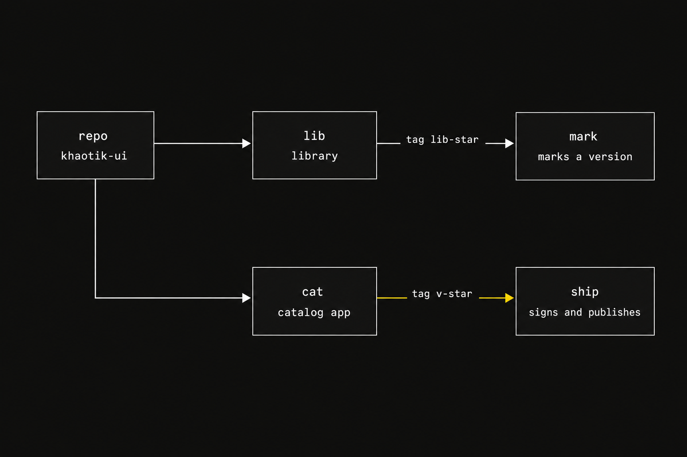
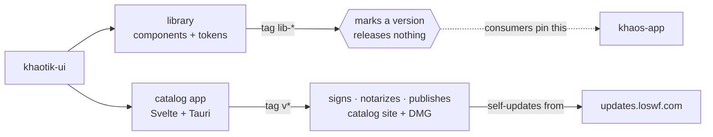

# khaotik-ui

The Khaos-branded component library, and the single home where the Khaos design
system is built and maintained. Successor to `khaotik-3` (tokens) and `ucs`
(components, compositions, and the catalog). Atoms, components and compositions
are hand-authored here and shared with every Khaos app as `@khaos-machine/khaotik-ui`.

## Published

| | Where | What |
| --- | --- | --- |
| **Catalog (web)** | [khaotik-catalog.loswf.com](https://khaotik-catalog.loswf.com) | The same components in the catalog shell, browsable without installing anything. |
| **Catalog (macOS)** | [Download the DMG](https://github.com/khaos-machine/khaotik-ui/releases/latest) † | The desktop playtest app — Developer-ID signed and notarized. |

† **This repo is private**, so the release link only resolves if you have access
to it — it returns 404 otherwise. That is also why the updater feed lives on S3
rather than on GitHub release assets. Without repo access, use the web catalog
above; it needs no install and tracks the same release.

The catalog site and the desktop app ship on a `v*` tag. The desktop app updates
itself from `updates.loswf.com/khaotik-catalog`, so an installed build offers the
next one without a re-download.

`khaotik-ui.loswf.com` served a Storybook catalog until D61 retired it. The
hosting behind it — the bucket, the CloudFront distribution and the DNS record —
was deleted on 2026-08-18 (issue #40), so the hostname no longer resolves. There
is no redirect: `khaotik-catalog.loswf.com` is the surviving site.

**Current versions** — the library is the newest `lib-*` tag
([lib releases](https://github.com/khaos-machine/khaotik-ui/releases?q=lib-)),
and the catalog app is the newest `v*` tag
([latest release](https://github.com/khaos-machine/khaotik-ui/releases/latest)).
The two version
independently and each owns a tag prefix: **`v*` releases the catalog** (it
signs, notarizes and publishes), while **`lib-*` marks a library version** and
releases nothing. Consumers pin a `lib-*` tag rather than a branch or a bare
SHA — `khaos-app` pinned a SHA and sat 24 commits behind without a signal that
it had.

> `0.2.0` carried a **breaking change** to the list components (D58), since retired, and it
> still applies to anything upgrading from `0.1.x`:
> `onSelectScene` / `onSelectDialogue` are now `onSelect`, and `selectedId` is
> `selectedKey` on `CharacterList` (which matches by name, not id). See `docs/decisions.md`.

## Two tags, two artifacts

The single thing to get right before consuming or releasing this repo: **one
repository, two independently versioned things, and the tag prefix decides which
one moves.**





Consumers pin a `lib-*` tag — not a branch, not a bare SHA. khaos-app pinned a
SHA and sat 24 commits behind with no signal that it had.

## Install + use (external apps)

```js
// the theme (dark default; flip html[data-theme="light"])
import '@khaos-machine/khaotik-ui/tokens/tokens.css'
import '@khaos-machine/khaotik-ui/tokens/tokens-extra.css' // the seven-way StatusTone bridge
import '@khaos-machine/khaotik-ui/tokens/utilities.css'    // .eyebrow / .surface — the atoms render these

// the atoms (Svelte; Phosphor icons need their CSS)
import { StatusPill, SelectableRow, ProviderBadge } from '@khaos-machine/khaotik-ui/components/svelte'
```

All three stylesheets are required. `utilities.css` is not optional polish —
five components render `class="eyebrow"` themselves, so without it every eyebrow
falls back to plain body text. `tokens.css` defines custom properties only; it
does not paint `body`, so a consuming app sets its own `color` and `background`
from the semantic tokens.

**Per-prop documentation is in your editor.** Every component ships a generated
`.svelte.d.ts` carrying a description and a real type for each prop, so hovering
`tone` shows what it does and the seven values it accepts. That is the library's
API reference — there is no separate site to consult.

**→ [`docs/using-the-library.md`](docs/using-the-library.md)** is the full
adoption guide: theming, the component inventory, the conventions that will bite
you, and the 0.2.0 migration.

Published on npm as `@khaos-machine/khaotik-ui` (Apache-2.0). Pin an exact version.

## Layout

- `tokens/` — `tokens.json` (source of truth) → `tokens.css` (generated by
  `build-tokens.py`), `tokens-extra.css` (the `--tone-*` StatusTone bridge),
  `utilities.css` (`.eyebrow` / `.surface`, the classes the atoms render), and
  `parse.js` (the parser the catalog's brand screens read `tokens.css`
  through — there were two once, they drifted, and the drift shipped a crash).
- `components/svelte/` — the atoms and compositions, one per file, on the
  semantic tokens.
- `assets/placeholders/` — pre-production artwork the kit ships (twelve
  character silhouettes, the story cover) so a component renders something
  honest before real imagery exists. Real art always wins.
- `apps/catalog/` — the component catalog (Svelte + Tauri), for playtesting
  atoms and compositions on devices against real KSPD data. The library's only
  component surface (D61).
- `docs/` — `decisions.md`, `harvest-khaos-machine-tokens.md`, `tokens-to-ui.md`.
- `scripts/` — the four gates below, plus `build-types.mjs` (generates the
  shipped `.d.ts`).

## Gates

```bash
npm run check-coverage  # the five below, in order
npm run check-catalog   # every exported component has a catalog fixture
npm run check-taxonomy  # every component is filed in a declared, labelled group
npm run check-consumer  # the package loads and type-checks the way a consumer loads it
npm run check-compile   # the catalog's build, which imports every export
npm run check-export-count  # every stated component count matches the exports

npm run check-types     # the shipped .d.ts have not drifted — a separate gate,
                        # not part of check-coverage; run it yourself
```

Exit 0 clean, 1 named gaps, 2 could-not-run — **a 2 is a red, not a pass.** All
of them run before a release is signed.

`check-compile` is the catalog's own vite build. It earns a place among the gates
because `fixtures.js` imports every export, so building the catalog compiles
every component — the job `build-storybook` used to do before Storybook was
retired (D61).

## Catalog (desktop playtest app)

```bash
cd apps/catalog
npm run dev             # Vite dev server (browser)
npm test                # vitest — the repo's only test surface
npm run build           # static web build
npx tauri dev           # the desktop app
npm run dev:mcp         # desktop app with the MCP bridge live (dev only)
```

Anything touching Rust needs cargo on PATH first:
`export PATH="$HOME/.cargo/bin:$PATH"`.

Tauri native build + release: see `.github/workflows/catalog-release.yml`, and
`apps/catalog/AGENTS.md` for the signing, notarization and updater details.

## Working

See `AGENTS.md` for the conventions (warm-gray theme, dense native type, D52
encoding, Ark UI, no generator) and the full working notes.
